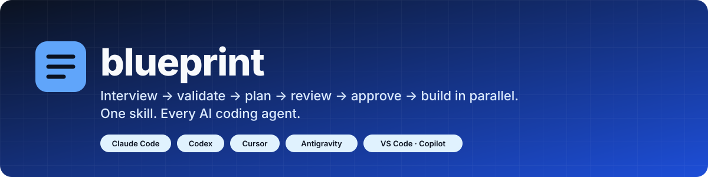
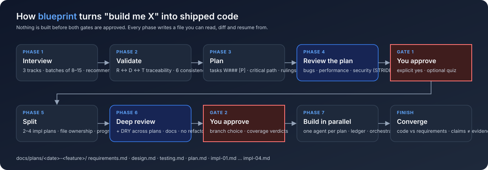
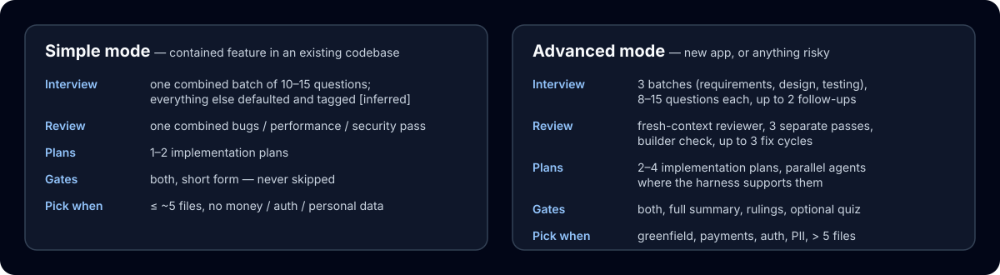

<p align="center">
  
</p>

<h1 align="center">blueprint</h1>

<p align="center">
  <b>The AI agent skill that interviews you properly, validates the answers, reviews its own plan for bugs, performance and security, waits for your approval, then builds with parallel agents.</b><br>
  Works in <b>Claude Code</b>, <b>OpenAI Codex</b>, <b>Cursor</b>, <b>Google Antigravity</b> and <b>VS Code / GitHub Copilot</b> from a single <code>SKILL.md</code>.
</p>

<p align="center">
  <a href="https://www.npmjs.com/package/blueprint-skill"></a>
  <a href="LICENSE"></a>
  
  
</p>

---

## Install in 10 seconds

```bash
npx blueprint-skill
```

The installer detects which coding agents you have, lets you pick one, several or all of them, shows exactly which folders it will write, and asks before touching anything.

<details>
<summary>More install options</summary>

```bash
npx blueprint-skill --all --yes                 # every detected agent, no prompts
npx blueprint-skill --client cursor --client codex
npx blueprint-skill --project .                 # install into this repository for your whole team
npx blueprint-skill --dry-run                   # show the plan, write nothing
npx blueprint-skill doctor                      # what is installed where, and which version
npx blueprint-skill@latest update               # update every copy a previous install wrote
npx blueprint-skill uninstall                   # remove exactly what was installed
npx blueprint-skill init                        # write a starter docs/plans/CONSTITUTION.md in this repo

npm i -g blueprint-skill && blueprint-skill     # persistent CLI
npx skills add sepandasadi/blueprint-skill      # via the skills.sh installer
git clone https://github.com/sepandasadi/blueprint-skill && cd blueprint-skill && ./install.sh   # no Node? bash fallback
```

Copies are real directories (never symlinks), anything replaced is backed up under `~/.blueprint-skill/backups/`, and every written path is recorded in a manifest so `uninstall` removes only what `install` wrote.
</details>

Then restart your agent and type:

```
/blueprint Build me a notes app with sharing
```

(`$blueprint` in Codex.) It picks simple or advanced mode for you and says which in one line; reply `advanced` or `simple` to switch, or put the word in the command.

### Shortcuts

| You type | What happens |
|---|---|
| `/blueprint from docs/idea.md` | Starts from a brief, spec or PRD you already have (a path, an attached file, or pasted text). Everything the brief answers is recorded with the brief as its source; you are asked only about what it leaves open. |
| `default` | Takes the recommended answer for this question. |
| `defaults for the rest of this track` | Takes the recommended answers for the rest of the current track. |
| `defaults for everything` | Ends the interview and goes straight to validation. Contradictions that matter are still asked about, and Gate 1 tells you how many decisions were defaulted. |
| `/blueprint status` | Read-only: which phase each plan folder is in, what's blocked, and what to type next. |
| `continue` | Resumes the unfinished plan folder (asks which one if there are several). |
| `npx blueprint-skill init` | Writes a starter `docs/plans/CONSTITUTION.md`: your project's MUST / SHOULD rules and a default mode, so you never get asked twice. |

## Updating

```bash
npx blueprint-skill@latest update
```

This reinstalls the newest version into every folder a previous install wrote, backs up each old copy first, and tells you to restart your agent. Keep the `@latest`: plain `npx blueprint-skill` can reuse an older copy npx has cached.

- **Knowing when to update.** Every run of the installer checks npm and prints one line when a newer version exists. The check gives up after 2 seconds and stays silent when you are offline. Set `BLUEPRINT_SKILL_NO_UPDATE_CHECK=1` to turn it off.
- **Seeing what you have.** `npx blueprint-skill doctor` lists every installed copy with its version, marks outdated ones, and prints the update command.
- **Upgrading from 0.1.x.** Those versions had no `update` command. The command above still works: copies from 0.1.x show as `unknown version` and are updated.
- **Without Node.** `git pull && ./install.sh update` does the same from a clone.
- **Installed with `npx skills add`?** That installer keeps its own records; update through it, or reinstall with `npx blueprint-skill`.
- **What changed.** Each release is listed on the [GitHub releases page](https://github.com/sepandasadi/blueprint-skill/releases).

## Why blueprint

Most coding agents, asked to "build me X", ask one question and start typing. We measured it: with no skill loaded, agents wrote their first source file at tool call 4–6, asked a single question, produced no requirements or design document, never reached the contradictions buried in the user's own answers, and treated a clarification as approval. See [`evals/results.md`](evals/results.md).

blueprint makes the agent behave like a senior engineer who has been burned before:

<p align="center"></p>

| Phase | What happens | What you get |
|---|---|---|
| **1 Interview** | Detailed questions in three tracks — requirements, system design, testing — asked one at a time (8–15 per track), each with *why it matters* and a *recommended* default. It never asks what your repo already answers. | `requirements.md`, `design.md`, `testing.md` with IDs (`R-01`, `D-01`, `T-01`), each decision carrying its grounds and a *reopen-if* |
| **2 Validate** | A traceability matrix (every requirement → design → test) and six consistency passes catch answers that cannot all be true ("end-to-end encrypted" *and* "server-side search"). | Contradictions surfaced with both answers verbatim, before anything is designed around them |
| **3 Plan** | Tasks `W001 [P] [R-03] … — path`, grouped parallel / sequential / independent, with a critical path and an *Ambiguities (must be empty)* section. | `plan.md` |
| **4 Review the plan** | A fresh-context reviewer runs bug, performance and security (STRIDE-lite) passes and a *builder check*. Findings are fixed in the plan, up to 3 cycles. | A review log you can read |
| **Gate 1** | Summary, rulings, one question. Nothing continues without an explicit yes. | Your decision |
| **5 Split** | 2–4 implementation plans partitioned by **file ownership**, shared interfaces frozen in a conflict table, each with its own progress log. | `impl-01.md … impl-04.md` |
| **6 Deep review** | Bugs, perf, security again — plus DRY across plans, documentation tasks, "would this need an immediate refactor?", and per-requirement coverage verdicts. | Gaps block Gate 2 |
| **Gate 2** | Plans, dependency order, what runs in parallel on *your* harness, branch choice. | Your decision |
| **7 Build** | One implementer agent per plan, dispatched in parallel where the harness allows (Claude Code, Codex), sequential elsewhere. Implementers never commit; the orchestrator verifies and commits each plan. | Commits per plan, ledger lines per task |
| **Converge** | Opens the code for every requirement. Checkboxes are claims, not evidence. | A final per-requirement grade |

Lose your context window halfway? **Resume** reads the ledgers, re-verifies `git status` and tests, records drift, and continues from the first unfinished task. Just want to know where things stand? `/blueprint status` reads the same files and changes nothing.

## Two modes

<p align="center"></p>

Simple mode collapses the interview into one shorter sequence and the reviews into one pass, and defaults to fewer plans. It still writes every artifact and still stops at both gates. The skill chooses for you after reading the repository: simple for a contained feature, advanced for a new app or anything touching money, auth or personal data. Say the other word to switch. To fix the choice for a repository, set `mode:` in `docs/plans/CONSTITUTION.md` (`auto`, `simple`, `advanced`, or `ask`).

## What makes it different

blueprint borrows the best idea from each of the tools in this space and adds what none of them do together.

| | blueprint | [superpowers](https://github.com/obra/superpowers) | [spec-kit](https://github.com/github/spec-kit) | [Simflow](https://github.com/SuStackx0/Simflow) | [vibemaster](https://github.com/liustack/vibemaster) |
|---|---|---|---|---|---|
| Detailed interview, three tracks, one question at a time with a recommendation | ✅ | one question at a time | ≤ 5 clarifications | one at a time | one at a time |
| Cross-track traceability matrix (R ↔ D ↔ T) | ✅ | — | requirement → task | — | — |
| Bug / performance / security review **of the plan** | ✅ | self-review | consistency only | security non-blocking | adversarial code review |
| 2–4 implementation plans by file ownership, each with a progress log | ✅ | one plan | one `tasks.md` | no plan files | — |
| Parallel implementer agents | ✅ where supported | forbidden | `[P]` marker only | ✅ | — |
| Two explicit approval gates | ✅ | one | — | — | one |
| Simple / advanced mode | ✅ | — | — | — | — |
| One portable `SKILL.md`, no CLI or hooks required | ✅ | plugin per harness | Python CLI | hooks | ✅ |
| Interactive cross-agent installer | ✅ | — | `specify init` | — | — |

Borrowed with thanks: hard approval gates, builder check and rulings ledger (superpowers); recommended options, clarification log and convergence pass (spec-kit); ambiguity blocks and coverage verdicts (Simflow); grounds + reopen-if and the stance-switch review (vibemaster); the dry-run / backup / manifest installer (rea). Details in [`docs/design-notes.md`](docs/design-notes.md).

## Where it works

| Agent | Reads the skill from | Parallel build |
|---|---|---|
| Claude Code | `~/.claude/skills/` | ✅ subagents in one message |
| OpenAI Codex | `~/.agents/skills/`, `~/.codex/skills/` | ✅ `spawn_agent` (multi-agent on) |
| Cursor | `~/.agents/skills/`, `~/.cursor/skills/` | sequential |
| Google Antigravity | `~/.gemini/antigravity/skills/` (project: `.agents/skills/`; CLI: `~/.gemini/antigravity-cli/skills/`) | sequential |
| VS Code / GitHub Copilot | `~/.agents/skills/`, `~/.copilot/skills/` | sequential |

The skill body never names a tool; `blueprint/references/harness-map.md` maps each action to the right tool per agent and degrades to a sequential fallback.

## What it writes in your project

```
docs/plans/2026-10-22-stripe-billing/
├── requirements.md   R-IDs, decisions with grounds + reopen-if, clarification log
├── design.md         D-IDs, interfaces, trust boundaries, performance targets
├── testing.md        T-IDs, acceptance criteria, negative tests
├── plan.md           tasks, traceability matrix, review log, rulings, convergence
├── impl-01.md        owned files, tasks as TDD steps, verification, progress log
└── impl-02.md
```

Optional: `docs/plans/CONSTITUTION.md` with MUST / SHOULD principles and a default mode (`npx blueprint-skill init` writes a starter). If present, every plan is checked against it and violations need a justified row.

## Repository layout

```
blueprint/            the skill (this is what gets installed)
  SKILL.md            ~180 lines, harness-neutral
  references/         question banks, templates, validation, review checklists, parallel execution, harness map
  assets/             starter CONSTITUTION.md (what `init` writes)
bin/blueprint-skill.js   interactive installer, updater and `init` (zero deps)
install.sh            bash fallback with identical behaviour
evals/                scenarios, scripted users, fixtures and results used to test the skill itself
docs/                 design notes and diagrams
```

## Testing the skill itself

The skill was built test-first: each scenario in `evals/scenarios/` was run by a fresh agent **without** the skill (baseline), then **with** it. The scripted `answers.md` files stand in for the user and contain deliberately contradictory answers. Results and verbatim agent rationalizations are in [`evals/results.md`](evals/results.md); they seed the Red Flags table in `SKILL.md`.

## Contributing

Issues and pull requests are welcome. If you add a question to a bank or a check to a review pass, add the scenario that fails without it.

## Disclaimer

blueprint is experimental software provided **as is**, without warranty of any kind. It is a set of instructions for AI coding agents; the plans, reviews and code those agents produce are generated by a language model and can be wrong, incomplete or insecure. **They are not a substitute for human review, security audit or testing.** You are responsible for everything an agent builds, commits or deploys while following this skill. The installer writes only to the skill folders it lists in its plan and backs up anything it replaces. This project is independent and is not affiliated with, endorsed by, or supported by Anthropic, OpenAI, Cursor, Google, GitHub or Microsoft; product names are used for identification only.

## License

[MIT](LICENSE) © Sepand Asadi
